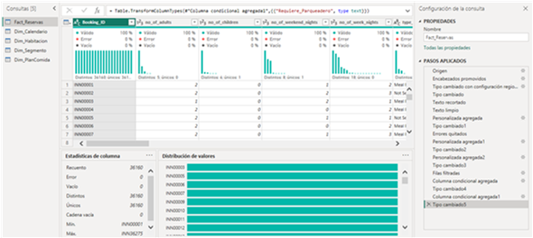
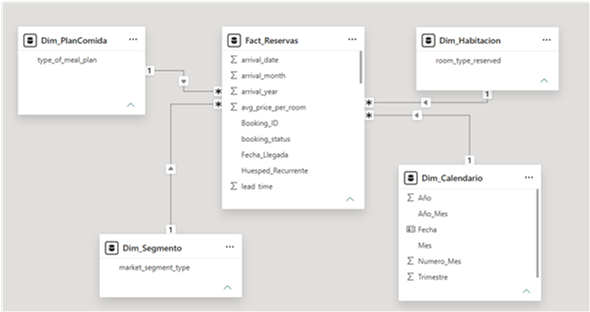
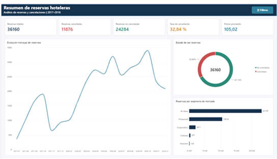
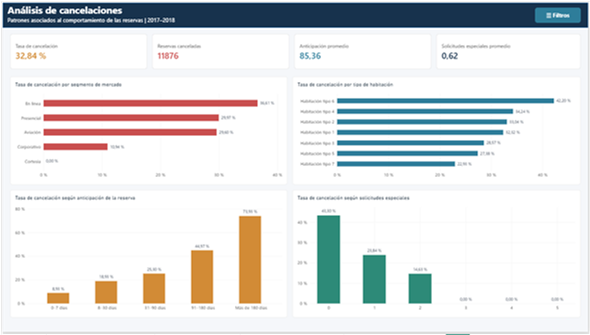
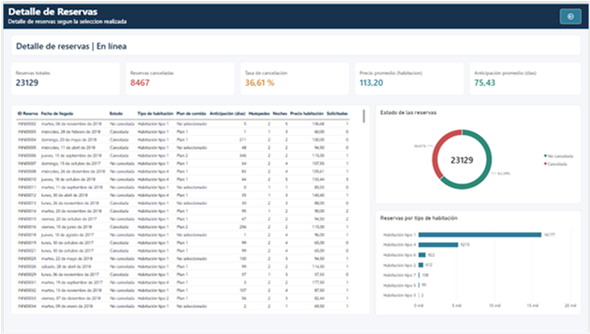
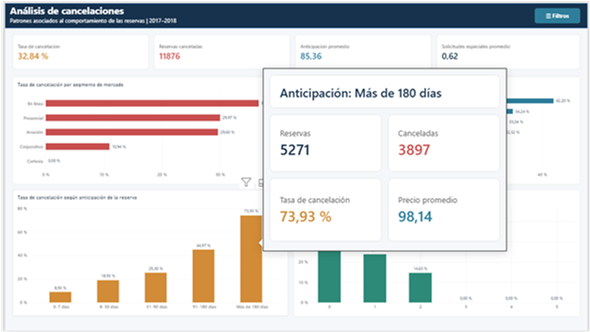

# Análisis del comportamiento de las reservas y patrones de cancelación hotelera mediante Power BI (2017–2018)

## Descripción

Proyecto desarrollado en Power BI para analizar el comportamiento de reservas hoteleras y patrones de cancelación durante 2017–2018. El repositorio reúne el dashboard, el archivo de datos de origen y la documentación técnica del proyecto.

## Objetivo

Analizar las reservas y sus patrones de cancelación mediante indicadores y visualizaciones que permitan explorar los resultados por las dimensiones disponibles en el modelo.

## Tecnologías utilizadas

- **Microsoft Power BI Desktop**: desarrollo del modelo y del dashboard.
- **Power Query**: limpieza, transformación y estandarización de los datos.
- **DAX**: creación de medidas para el análisis.
- **CSV**: formato del conjunto de datos de origen.

## Dataset

El archivo de origen es `data/Hotel Reservations.csv`. La base inicial contiene **36.275 registros y 19 variables**. Tras la limpieza se conservaron **36.160 registros válidos**.

Antes de publicar o reutilizar el dataset, verifica que su distribución sea compatible con las condiciones de uso de la fuente original.

## Proceso ETL y preparación de datos

La preparación se realizó en **Power Query** e incluyó limpieza, transformación y estandarización. En particular:

- Se eliminaron **37 registros** con fecha inválida correspondiente al 29 de febrero de 2018.
- Se eliminaron **78 registros** con cero noches y precio promedio igual a cero.
- No se encontraron valores duplicados en `Booking_ID`.
- La base final quedó con **36.160 registros**.

La captura siguiente muestra el trabajo de limpieza y transformación realizado en Power Query.



## Modelo dimensional

El modelo sigue un esquema estrella con la tabla de hechos y las dimensiones siguientes:

- `Fact_Reservas`
- `Dim_Calendario`
- `Dim_Habitacion`
- `Dim_Segmento`
- `Dim_PlanComida`

El diagrama muestra la organización del modelo dimensional y las relaciones entre la tabla de hechos y sus dimensiones.



## Medidas DAX principales

| Medida | Uso analítico |
|---|---|
| `Total_Reservas` | Total de reservas analizadas. |
| `Reservas_Canceladas` | Conteo de reservas canceladas. |
| `Reservas_No_Canceladas` | Conteo de reservas no canceladas. |
| `Tasa_Cancelacion` | Proporción de reservas canceladas. |
| `Precio_Promedio_Habitacion` | Precio promedio de habitación. |
| `Lead_Time_Promedio` | Anticipación promedio de las reservas, en días. |
| `Noches_Promedio` | Promedio de noches por reserva. |
| `Huespedes_Promedio` | Promedio de huéspedes por reserva. |

## Páginas del dashboard

1. **Resumen de reservas**: vista general de los principales indicadores del conjunto analizado.

	La página de resumen reúne la vista general de los indicadores principales.

	

2. **Análisis de cancelaciones**: exploración de las cancelaciones y sus patrones, incluida su relación con la anticipación de la reserva.

	Esta vista permite explorar los patrones de cancelación, incluida su relación con la anticipación de la reserva.

	

3. **Detalle de reservas**: consulta del detalle de las reservas mediante los filtros disponibles.

	La página de detalle ofrece una vista de las reservas para su consulta dentro del dashboard.

	

## Funcionalidades interactivas

- Filtros y segmentadores.
- Bookmarks para navegar entre vistas guardadas.
- Drill-through para consultar información de detalle.
- Tooltip personalizado.
- Edición de interacciones entre visualizaciones.

El tooltip personalizado complementa la exploración de los datos con información contextual.



## Principales resultados

- **36.160** reservas válidas.
- **11.876** reservas canceladas y **24.284** no canceladas.
- **32,84 %** de tasa de cancelación.
- **105,02** de precio promedio de habitación.
- **85,36 días** de anticipación promedio.
- La tasa de cancelación fue de **8,93 %** para reservas realizadas con **0–7 días** de anticipación y de **73,93 %** para reservas con **más de 180 días** de anticipación.

## Estructura del repositorio

```text
/
├── README.md
├── .gitignore
├── dashboard/
│   └── Proyecto_Reservas_Hoteleras.pbix
├── data/
│   └── Hotel Reservations.csv
├── docs/
│   ├── Análisis del comportamiento de las reservas y patrones de cancelación hotelera mediante Power BI.docx
│   └── Análisis del comportamiento de las reservas y patrones de cancelación hotelera mediante Power BI.pdf
└── images/
```

## Cómo abrir el proyecto

1. Descarga o clona este repositorio.
2. Abre `dashboard/Proyecto_Reservas_Hoteleras.pbix` con **Power BI Desktop**.
3. Si necesitas actualizar los datos, verifica en Power Query que el origen apunte a `data/Hotel Reservations.csv` y actualiza el modelo.
4. Consulta la documentación técnica en formato [Word](docs/An%C3%A1lisis%20del%20comportamiento%20de%20las%20reservas%20y%20patrones%20de%20cancelaci%C3%B3n%20hotelera%20mediante%20Power%20BI.docx) o [PDF](docs/An%C3%A1lisis%20del%20comportamiento%20de%20las%20reservas%20y%20patrones%20de%20cancelaci%C3%B3n%20hotelera%20mediante%20Power%20BI.pdf).

## Autor

**Juan Esteban Escobar Portilla**
